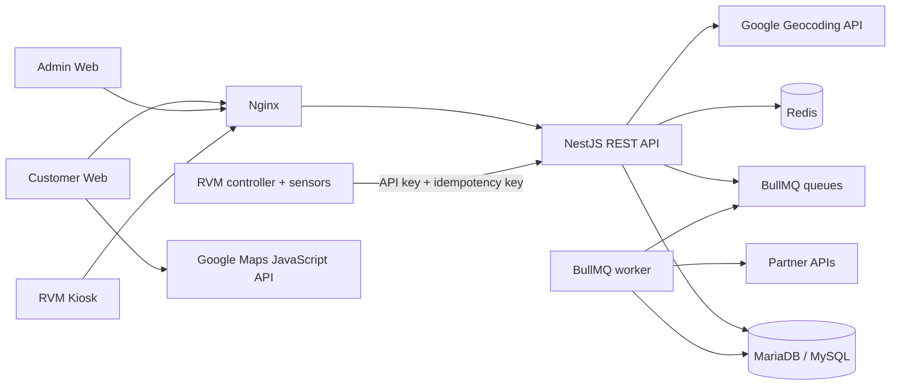

# Kiến trúc BravoForest

## Nguyên tắc dữ liệu

- MariaDB là nguồn sự thật cho tài khoản, máy, phiên tái chế, ví và voucher.
- Số dư ví được suy ra từ sổ cái `wallet_transactions`; ứng dụng không cập nhật số dư trực tiếp.
- Hoàn tất phiên tái chế và cộng điểm chạy trong một transaction, với khóa bản ghi để tránh cộng hai lần.
- Đổi voucher, trừ điểm và giữ mã voucher chạy trong một transaction. Việc gọi đối tác được đưa vào BullMQ và dùng `idempotency_key` để có thể retry an toàn.
- Redis lưu dữ liệu ngắn hạn, rate limit, QR đăng nhập và queue. Redis không thay thế dữ liệu nghiệp vụ trong MariaDB.

## Môi trường local

- Ba ứng dụng Next.js chạy ở các cổng `3000`, `3001`, `3002`.
- NestJS API chạy ở cổng `4000`.
- MariaDB dùng XAMPP ở cổng `3306`.
- Redis có thể chạy bằng Docker ở cổng `6379`.

## Hướng production

- Nginx kết thúc TLS, định tuyến và giới hạn kích thước request.
- Ba hostname customer, admin và kiosk phải trỏ về máy chủ; chứng chỉ TLS cần có đủ ba hostname trong SAN và được đặt tại `infrastructure/certs/`.
- Cấu hình Nginx chỉ thay thế ba biến hostname trong template, giữ nguyên các biến runtime như `$host` và `$request_uri`; host không được khai báo sẽ bị từ chối.
- Mỗi web, API và worker chạy trong container riêng.
- MariaDB và Redis dùng volume bền vững hoặc dịch vụ managed, đặt trong private network.
- Secret được cấp qua secret manager của nền tảng triển khai; không build vào image.
- API và worker có health check riêng để nền tảng tự thay thế instance lỗi.
